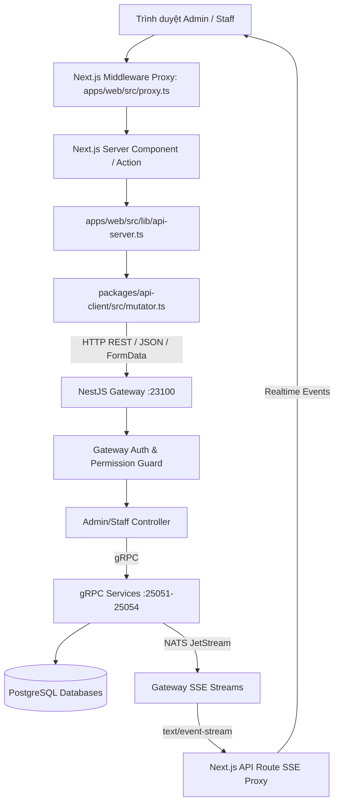

# TÀI LIỆU BÀN GIAO DỰ ÁN FRONTEND ADMIN (BREWLITE)
*File: `ADMIN_PROJECT_HANDOVER.md`*
*Mục đích: Cung cấp đầy đủ cấu trúc, hợp đồng API Backend, luồng dữ liệu và hướng dẫn cho AI tiếp tục hoàn thiện Frontend Admin mà không sửa Backend.*

---

## 1. TỔNG QUAN KIẾN TRÚC DỰ ÁN

- **Mô hình kiến trúc**: Monorepo quản lý bởi `pnpm` workspaces và `turborepo`.
- **Frontend App (`apps/web`)**: Next.js 16 (App Router), React 19, TypeScript, Tailwind CSS v4, DaisyUI v5.
- **Shared Packages (`packages/`)**:
  - `@brewlite/api-client` (`packages/api-client`): Bộ API client tự động sinh bởi Orval từ OpenAPI 3.1 của Gateway, sử dụng custom fetcher mutator (`mutator.ts`).
  - `@brewlite/contracts` (`packages/contracts`): Định nghĩa Enums (`Role`, `OrderStatus`, `UserStatus`), constants, DTO types, logic chuyển trạng thái đơn hàng (`order-lifecycle.ts`), định dạng `LocalizedText` `{ vi: string, en?: string }`.
  - `@brewlite/nest-common` & `@brewlite/config`: Thư viện tiện ích chung cho backend NestJS.
- **Backend Services (`services/`)**:
  - `services/gateway`: NestJS REST API Gateway (Port `23100`). Chịu trách nhiệm xác thực JWT (`bl_at`), phân quyền (`@RequirePermission()`), đóng gói chuẩn response envelope `{ data, meta? }` và lỗi `{ error: { code, details, requestId } }`, đồng thời stream Server-Sent Events (SSE).
  - `services/identity`: Microservice quản lý tài khoản, người dùng, phân quyền, mật khẩu qua gRPC (Port `25051`, PostgreSQL database `brewlite_identity`).
  - `services/catalog`: Microservice quản lý danh mục, sản phẩm, kích cỡ (S/M/L), topping, tồn kho (`stockQty`, `version`) qua gRPC (Port `25052`, PostgreSQL database `brewlite_catalog`).
  - `services/ordering`: Microservice quản lý tạo đơn, vòng đời đơn hàng, khuyến mãi (`promotions`), tích điểm qua gRPC (Port `25053`, PostgreSQL database `brewlite_ordering`, NATS JetStream event streaming).
  - `services/payment`: Microservice xử lý thanh toán, hoàn tiền qua gRPC (Port `25054`).

---

## 2. CẤU TRÚC FRONTEND VÀ BACKEND

```
brewlite/
├── apps/
│   └── web/                                  # Frontend Next.js 16
│       ├── src/
│       │   ├── app/
│       │   │   ├── admin/                    # Phân hệ Admin
│       │   │   │   ├── categories/           # Quản lý danh mục
│       │   │   │   ├── products/             # Quản lý sản phẩm & chi tiết
│       │   │   │   │   └── [id]/             # Size, topping gán kèm, upload ảnh
│       │   │   │   ├── toppings/             # Quản lý topping
│       │   │   │   ├── promotions/           # Quản lý mã khuyến mãi
│       │   │   │   ├── users/                # Quản lý người dùng, vai trò, khóa
│       │   │   │   ├── dashboard-client.tsx  # Dashboard thống kê
│       │   │   │   ├── layout.tsx            # Bọc AdminShell + currentUser
│       │   │   │   └── page.tsx              # Server Component fetch metrics
│       │   │   ├── staff/                    # Phân hệ Nhân viên Barista/Thu ngân
│       │   │   │   ├── orders/               # Bảng Kanban đơn hàng + SSE realtime
│       │   │   │   ├── inventory/            # Bật/tắt món & topping, chỉnh tồn kho
│       │   │   │   └── layout.tsx
│       │   │   ├── login/                    # Trang đăng nhập Server Action
│       │   │   └── api/staff/orders/events/  # Next.js Route Handler proxy SSE
│       │   ├── components/
│       │   │   ├── layout/admin-shell.tsx    # Header, Sidebar, User info, Logout
│       │   │   └── ui/                       # BrandLogo, EmptyState, LocalizedInput, Pagination
│       │   ├── lib/
│       │   │   ├── api-server.ts             # Server Action caller, cookie helper
│       │   │   └── zod-schemas.ts            # Client & Server validation schemas
│       │   ├── proxy.ts                      # Middleware route guard & token refresh
│       │   └── mocks/admin-data.ts           # Types & mock interfaces
├── packages/
│   ├── api-client/                           # Orval generated API calls & mutator
│   └── contracts/                            # Enums, shared domain contracts
└── services/
    ├── gateway/                              # REST API Gateway (NestJS)
    │   ├── src/modules/
    │   │   ├── catalog/                      # admin-categories, admin-products, admin-toppings, staff-products, staff-toppings
    │   │   ├── admin-users/                  # admin-users.controller.ts
    │   │   ├── promotions/                   # promotions.controller.ts
    │   │   ├── staff-orders/                 # staff-orders.controller.ts
    │   │   └── auth/                         # auth.controller.ts
    │   ├── src/events/                       # events.controller.ts (SSE Stream)
    │   └── openapi.json                      # Full OpenAPI Specification 3.1
    ├── catalog/prisma/schema.prisma          # Database schema catalog
    ├── identity/prisma/schema.prisma         # Database schema identity
    └── ordering/prisma/schema.prisma         # Database schema ordering
```

---

## 3. DANH SÁCH FILE FRONTEND ADMIN

| File | Phân nhóm | Vai trò cụ thể | Dependencies chính | Trạng thái |
|---|---|---|---|---|
| `apps/web/src/proxy.ts` | Auth Guard | Middleware kiểm tra JWT `bl_at`, refresh token qua `bl_rt`, chặn role `STAFF` vào `/admin/*` | `next/server`, `env.schema` | Đã xác minh |
| `apps/web/src/lib/api-server.ts` | Server Helpers | Cấu hình Bearer token từ cookie `bl_at`, đọc user từ `bl_user`, wrap `executeServerAction` | `@brewlite/api-client`, `next/headers` | Đã xác minh |
| `apps/web/src/lib/zod-schemas.ts` | Validation | Zod schema cho categories, products, toppings, promotions, lock user, cancel paid | `zod` | Đã xác minh |
| `apps/web/src/components/layout/admin-shell.tsx` | Layout | Shell giao diện Admin: Sidebar navigation, User badge, nút đăng xuất, responsive | `lucide-react`, `next/link` | Đã xác minh |
| `apps/web/src/components/ui/localized-input.tsx` | UI Component | Input song ngữ (Tiếng Việt `vi` và Tiếng Anh `en`) | React | Đã xác minh |
| `apps/web/src/components/ui/empty-state.tsx` | UI Component | Trạng thái rỗng chuyên nghiệp có icon và nút hành động | React | Đã xác minh |
| `apps/web/src/components/ui/pagination.tsx` | UI Component | Thanh điều hướng phân trang chuẩn URL query | React | Đã xác minh |
| `apps/web/src/app/admin/layout.tsx` | Page Layout | Bọc layout lấy `currentUser` truyền cho `AdminShell` | `api-server.ts`, `admin-shell.tsx` | Đã xác minh |
| `apps/web/src/app/admin/page.tsx` | Dashboard | Server component gọi API tổng hợp số liệu danh mục, sản phẩm, đơn hàng | `@brewlite/api-client` | Đã xác minh |
| `apps/web/src/app/admin/dashboard-client.tsx` | Dashboard | Client component vẽ biểu đồ doanh thu, thống kê, bảng tóm tắt | React | Đã xác minh |
| `apps/web/src/app/admin/categories/page.tsx` | Categories | Server component tải danh sách danh mục | `api-client` | Đã xác minh |
| `apps/web/src/app/admin/categories/actions.ts` | Categories | Server Actions: tạo, cập nhật, xóa mềm, khôi phục danh mục | `api-server.ts`, `zod-schemas.ts` | Đã xác minh |
| `apps/web/src/app/admin/categories/categories-client.tsx` | Categories | Giao diện quản lý danh mục: bảng, modal thêm/sửa, modal xác nhận chuyển thùng rác/khôi phục, kiểm tra sản phẩm đang dùng | React, `actions.ts` | Đã xác minh |
| `apps/web/src/app/admin/products/page.tsx` | Products | Server component tải danh sách sản phẩm phân trang | `api-client` | Đã xác minh |
| `apps/web/src/app/admin/products/actions.ts` | Products | Server Actions: tạo, sửa, xóa, khôi phục sản phẩm | `api-server.ts`, `zod-schemas.ts` | Đã xác minh |
| `apps/web/src/app/admin/products/products-client.tsx` | Products | Danh sách sản phẩm, lọc theo danh mục, modal thêm sản phẩm, nút chuyển vào thùng rác/khôi phục | React, `actions.ts` | Đã xác minh |
| `apps/web/src/app/admin/products/[id]/page.tsx` | Product Detail | Server component tải chi tiết 1 sản phẩm kèm sizes, toppings có sẵn | `api-client` | Đã xác minh |
| `apps/web/src/app/admin/products/[id]/product-editor.tsx` | Product Detail | Chỉnh sửa thông tin cơ bản, chọn topping gán kèm, cập nhật giá từng size (S/M/L), upload và xóa ảnh món | React, `actions.ts` | Đã xác minh |
| `apps/web/src/app/admin/toppings/page.tsx` | Toppings | Server component tải danh sách topping | `api-client` | Đã xác minh |
| `apps/web/src/app/admin/toppings/actions.ts` | Toppings | Server Actions: tạo, sửa, xóa, khôi phục topping | `api-server.ts`, `zod-schemas.ts` | Đã xác minh |
| `apps/web/src/app/admin/toppings/toppings-client.tsx` | Toppings | Danh sách topping, bảng giá, trạng thái khả dụng, modal xác nhận thùng rác | React, `actions.ts` | Đã xác minh |
| `apps/web/src/app/admin/promotions/page.tsx` | Promotions | Server component tải danh sách mã khuyến mãi | `api-client` | Đã xác minh |
| `apps/web/src/app/admin/promotions/actions.ts` | Promotions | Server Actions: tạo mã, cập nhật hạn dùng/lượt dùng, xóa mềm, khôi phục | `api-server.ts`, `zod-schemas.ts` | Đã xác minh |
| `apps/web/src/app/admin/promotions/promotions-client.tsx` | Promotions | Bảng khuyến mãi, tự động viết hoa mã, kiểm tra ngày bắt đầu/kết thúc | React, `actions.ts` | Đã xác minh |
| `apps/web/src/app/admin/users/page.tsx` | Users | Server component tải danh sách tài khoản người dùng | `api-client` | Đã xác minh |
| `apps/web/src/app/admin/users/actions.ts` | Users | Server Actions: đổi vai trò (ADMIN/STAFF/CUSTOMER), khóa tài khoản kèm lý do, mở khóa, vô hiệu hóa tài khoản | `api-server.ts`, `zod-schemas.ts` | Đã xác minh |
| `apps/web/src/app/admin/users/users-client.tsx` | Users | Quản lý người dùng, phân quyền, badge vai trò, cấm tự thao tác trên chính mình (`isSelf`) | React, `actions.ts` | Đã xác minh |
| `apps/web/src/app/staff/orders/orders-client.tsx` | Orders (Staff) | Bảng điều phối đơn hàng (Kanban), SSE cập nhật thời gian thực, chuyển trạng thái đơn hàng (CONFIRMED -> PREPARING -> READY -> COMPLETED), hủy đơn kèm ghi chú | React, SSE, `actions.ts` | Đã xác minh |
| `apps/web/src/app/staff/inventory/inventory-client.tsx` | Inventory (Staff) | Điều chỉnh bật/tắt phục vụ món, bật/tắt topping, cập nhật tồn kho với kiểm tra phiên bản `expectedVersion` | React, `actions.ts` | Đã xác minh |
| `apps/web/src/app/login/login-client.tsx` | Auth | Form đăng nhập email/mật khẩu, ghi nhận cookie `bl_at`, `bl_rt`, `bl_user` | React, `actions.ts` | Đã xác minh |

---

## 4. DANH SÁCH FILE BACKEND LIÊN QUAN ĐẾN ADMIN

| File | Module Backend | Vai trò trong luồng xử lý | Endpoint & Quyền hạn | Trạng thái |
|---|---|---|---|---|
| `services/gateway/src/modules/auth/auth.controller.ts` | Auth Gateway | Tiếp nhận đăng nhập, cấp JWT, refresh token | `POST /api/v1/auth/login`, `POST /api/v1/auth/refresh` | Đã xác minh |
| `services/gateway/src/modules/catalog/admin-categories.controller.ts` | Catalog Gateway | CRUD Danh mục sản phẩm | `GET/POST/PATCH/DELETE /api/v1/admin/categories` (`menu.manage`) | Đã xác minh |
| `services/gateway/src/modules/catalog/admin-products.controller.ts` | Catalog Gateway | CRUD Sản phẩm, upload ảnh multipart, cập nhật size/topping | `GET/POST/PATCH/DELETE /api/v1/admin/products`, `PUT :id/sizes`, `PUT :id/toppings`, `PUT :id/image` (`menu.manage`) | Đã xác minh |
| `services/gateway/src/modules/catalog/admin-toppings.controller.ts` | Catalog Gateway | CRUD Topping | `GET/POST/PATCH/DELETE /api/v1/admin/toppings` (`menu.manage`) | Đã xác minh |
| `services/gateway/src/modules/catalog/staff-products.controller.ts` | Catalog Gateway | Bật/tắt món và cập nhật tồn kho nhân viên | `GET /api/v1/staff/products`, `PATCH :id/availability`, `PATCH :id/stock` (`stock.update`) | Đã xác minh |
| `services/gateway/src/modules/catalog/staff-toppings.controller.ts` | Catalog Gateway | Bật/tắt topping phía nhân viên | `PATCH /api/v1/staff/toppings/:id/availability` (`stock.update`) | Đã xác minh |
| `services/gateway/src/modules/promotions/promotions.controller.ts` | Ordering Gateway | Quản lý mã khuyến mãi | `GET/POST/GET :id/PATCH :id/DELETE :id/POST :id/restore /api/v1/admin/promotions` (`promotion.manage`) | Đã xác minh |
| `services/gateway/src/modules/admin-users/admin-users.controller.ts` | Identity Gateway | Quản lý người dùng, đổi role, khóa/mở khóa tài khoản | `GET/PATCH :id/role/POST :id/lock/POST :id/unlock/DELETE :id /api/v1/admin/users` (`user.manage`) | Đã xác minh |
| `services/gateway/src/modules/staff-orders/staff-orders.controller.ts` | Ordering Gateway | Xem board đơn hàng, chuyển trạng thái đơn, hủy đơn đã thanh toán | `GET /api/v1/staff/orders`, `POST :id/status`, `POST :id/cancel` (`order.board.read`, `order.status.update`, `order.cancel.paid`) | Đã xác minh |
| `services/gateway/src/events/events.controller.ts` | Event Gateway | Server-Sent Events stream luồng sự kiện đơn hàng thời gian thực | `GET /api/v1/staff/orders/events` (`order.board.read`) | Đã xác minh |
| `services/gateway/src/auth/auth.guard.ts` | Auth Guard | Middleware kiểm tra JWT Bearer token và inject user context | Toàn bộ các API được bảo vệ | Đã xác minh |
| `services/gateway/src/auth/permission.guard.ts` | RBAC Guard | Kiểm tra quyền cụ thể của user đối với endpoint | Toàn bộ endpoint có `@RequirePermission()` | Đã xác minh |
| `services/gateway/openapi.json` | OpenAPI Spec | Đặc tả toàn bộ OpenAPI 3.1 của Gateway | Đầu vào để Orval sinh `@brewlite/api-client` | Đã xác minh |
| `services/catalog/prisma/schema.prisma` | DB Schema | Schema bảng categories, products, product_sizes, toppings, product_toppings | Định nghĩa cấu trúc lưu trữ Catalog | Đã xác minh |
| `services/identity/prisma/schema.prisma` | DB Schema | Schema bảng users, passwords, roles, permissions | Định nghĩa cấu trúc người dùng và quyền | Đã xác minh |
| `services/ordering/prisma/schema.prisma` | DB Schema | Schema bảng orders, order_items, promotions, loyalty_accounts | Định nghĩa đơn hàng và khuyến mãi | Đã xác minh |

---

## 5. BẢNG ĐỐI CHIẾU FRONTEND ↔ BACKEND

| Chức năng Admin / Staff | Frontend File & Hook/Action | API Service Client | Backend Endpoint | Nghiệp vụ xử lý & Quy tắc | Trạng thái |
|---|---|---|---|---|---|
| **Đăng nhập hệ thống** | `app/login/actions.ts` | `authControllerLogin` | `POST /api/v1/auth/login` | Xác thực email/password, lưu cookie `bl_at` (15p), `bl_rt` (30d), `bl_user` | Đã kiểm chứng |
| **Thống kê Dashboard** | `app/admin/page.tsx` | List controllers (Users, Cat, Top, Prod, Promo, Orders) | `GET /api/v1/admin/*`, `GET /api/v1/staff/orders` | Tải dữ liệu song song qua Promise.all, đếm tổng số lượng và doanh thu | Đã kiểm chứng |
| **Xem danh mục** | `admin/categories/page.tsx` | `adminCategoriesControllerList` | `GET /api/v1/admin/categories` | Lọc theo `deleted: false` hoặc `deleted: true` | Đã kiểm chứng |
| **Tạo danh mục** | `admin/categories/actions.ts` | `adminCategoriesControllerCreate` | `POST /api/v1/admin/categories` | Kiểm tra tên song ngữ `vi`/`en`, chặn trùng tên `CATEGORY_NAME_TAKEN` | Đã kiểm chứng |
| **Sửa danh mục** | `admin/categories/actions.ts` | `adminCategoriesControllerUpdate` | `PATCH /api/v1/admin/categories/:id` | Cập nhật tên song ngữ hoặc thứ tự hiển thị | Đã kiểm chứng |
| **Xóa mềm danh mục** | `admin/categories/actions.ts` | `adminCategoriesControllerDelete` | `DELETE /api/v1/admin/categories/:id` | Chặn nếu còn sản phẩm hoạt động (`CATEGORY_IN_USE`), trả về HTTP 204 | Đã kiểm chứng |
| **Khôi phục danh mục** | `admin/categories/actions.ts` | `adminCategoriesControllerRestore` | `POST /api/v1/admin/categories/:id/restore` | Khôi phục bản ghi đã xóa mềm | Đã kiểm chứng |
| **Xem sản phẩm** | `admin/products/page.tsx` | `adminProductsControllerList` | `GET /api/v1/admin/products` | Hỗ trợ phân trang `page`, `pageSize`, lọc danh mục `categoryId` | Đã kiểm chứng |
| **Tạo sản phẩm mới** | `admin/products/actions.ts` | `adminProductsControllerCreate` | `POST /api/v1/admin/products` | Yêu cầu `name`, `basePriceVnd`, tối thiểu 1 size (S/M/L) | Đã kiểm chứng |
| **Chi tiết sản phẩm** | `admin/products/[id]/page.tsx` | `adminProductsControllerGet` | `GET /api/v1/admin/products/:id` | Trả về thông tin sản phẩm, danh sách size và topping đã gán | Đã kiểm chứng |
| **Cập nhật thông tin món**| `admin/products/[id]/product-editor.tsx` | `adminProductsControllerUpdate` | `PATCH /api/v1/admin/products/:id` | Cập nhật tên, mô tả song ngữ, danh mục, giá cơ sở | Đã kiểm chứng |
| **Cập nhật các size món**| `admin/products/[id]/product-editor.tsx` | `adminProductsControllerReplaceSizes` | `PUT /api/v1/admin/products/:id/sizes` | Ghi đè toàn bộ danh sách size và chênh lệch giá `priceDeltaVnd` | Đã kiểm chứng |
| **Gán danh sách topping**| `admin/products/[id]/product-editor.tsx` | `adminProductsControllerReplaceToppings` | `PUT /api/v1/admin/products/:id/toppings`| Ghi đè mảng `toppingIds` được phép chọn kèm sản phẩm | Đã kiểm chứng |
| **Upload ảnh món ăn** | `admin/products/[id]/product-editor.tsx` | `adminProductsControllerSetImage` | `PUT /api/v1/admin/products/:id/image` | Gửi multipart/form-data qua field `file`, kích thước tối đa 2MB | Đã kiểm chứng |
| **Xóa ảnh món ăn** | `admin/products/[id]/product-editor.tsx` | `adminProductsControllerClearImage` | `DELETE /api/v1/admin/products/:id/image` | Xóa ảnh món, trả về HTTP 204 | Đã kiểm chứng |
| **Xóa mềm sản phẩm** | `admin/products/actions.ts` | `adminProductsControllerDelete` | `DELETE /api/v1/admin/products/:id` | Đánh dấu `deletedAt`, trả về HTTP 204 | Đã kiểm chứng |
| **Khôi phục sản phẩm** | `admin/products/actions.ts` | `adminProductsControllerRestore` | `POST /api/v1/admin/products/:id/restore` | Khôi phục sản phẩm từ thùng rác | Đã kiểm chứng |
| **Xem topping** | `admin/toppings/page.tsx` | `adminToppingsControllerList` | `GET /api/v1/admin/toppings` | Lọc theo `deleted: false` | Đã kiểm chứng |
| **Tạo & sửa topping** | `admin/toppings/actions.ts` | `adminToppingsControllerCreate/Update`| `POST/PATCH /api/v1/admin/toppings` | Tên song ngữ, đơn giá VNĐ | Đã kiểm chứng |
| **Xóa & khôi phục topping**| `admin/toppings/actions.ts`| `adminToppingsControllerDelete/Restore`| `DELETE/POST :id/restore /api/v1/admin/toppings` | Xóa mềm / Khôi phục | Đã kiểm chứng |
| **Quản lý khuyến mãi** | `admin/promotions/actions.ts` | `promotionsControllerList/Create/Update`| `GET/POST/PATCH/DELETE /api/v1/admin/promotions`| Mã viết hoa alphanumeric, hạn dùng, giá trị giảm (PERCENT/FIXED) | Đã kiểm chứng |
| **Quản lý người dùng** | `admin/users/actions.ts` | `adminUsersControllerList/ChangeRole` | `GET/PATCH :id/role /api/v1/admin/users` | Đổi vai trò ADMIN/STAFF/CUSTOMER; cấm tự đổi role chính mình | Đã kiểm chứng |
| **Khóa / Mở khóa user** | `admin/users/actions.ts` | `adminUsersControllerLock/Unlock` | `POST :id/lock, POST :id/unlock /api/v1/admin/users` | Khóa có lý do bắt buộc; cấm tự khóa chính mình (`SELF_ACTION_FORBIDDEN`)| Đã kiểm chứng |
| **Vô hiệu hóa user** | `admin/users/actions.ts` | `adminUsersControllerDeactivate` | `DELETE /api/v1/admin/users/:id` | Vô hiệu hóa người dùng (cấm xóa admin cuối cùng `LAST_ADMIN`) | Đã kiểm chứng |
| **Board đơn hàng Kanban**| `staff/orders/orders-client.tsx` | `staffOrdersControllerListBoard` | `GET /api/v1/staff/orders` | Hiển thị các cột trạng thái đơn hàng (CONFIRMED, PREPARING, READY...) | Đã kiểm chứng |
| **SSE sự kiện đơn hàng** | `app/api/staff/orders/events/route.ts` | EventSource `/api/staff/orders/events` | `GET /api/v1/staff/orders/events` | Stream sự kiện `order.status` qua Server-Sent Events | Đã kiểm chứng |
| **Chuyển trạng thái đơn**| `staff/orders/actions.ts` | `staffOrdersControllerAdvanceStatus` | `POST /api/v1/staff/orders/:id/status` | Chuyển trạng thái theo quy tắc nghiêm ngặt trong `order-lifecycle.ts` | Đã kiểm chứng |
| **Hủy đơn đã thanh toán**| `staff/orders/actions.ts` | `staffOrdersControllerCancelPaid` | `POST /api/v1/staff/orders/:id/cancel` | Bắt buộc nhập lý do/ghi chú hủy đơn (`CancelPaidDto`) | Đã kiểm chứng |
| **Cập nhật kho & khả dụng**| `staff/inventory/actions.ts` | `staffProductsControllerSetStockQty/Availability`| `PATCH /api/v1/staff/products/:id/*` | Kiểm tra xung đột phiên bản `expectedVersion` để tránh ghi đè dữ liệu cũ | Đã kiểm chứng |

---

## 6. LUỒNG DỮ LIỆU VÀ QUAN HỆ PHỤ THUỘC



---

## 7. CÁC ĐIỂM ĐÃ SỬA HOÀN TẤT VÀ CÔNG VIỆC TỒN ĐỌNG CẦN LƯU Ý

### Những nội dung đã được xử lý hoàn hảo:
1. **Mutator FormData Upload**: Đã sửa `packages/api-client/src/mutator.ts` để không tự động gắn header `Content-Type: application/json` khi payload là `FormData`. Nhờ đó tính năng upload ảnh sản phẩm hoạt động trơn tru.
2. **Chuẩn hóa Zod Schemas**: Đã xử lý `optionalLocalizedTextSchema` cho mô tả sản phẩm (cho phép bỏ trống hoặc nhập đủ cả 2 thứ tiếng) và regex mã khuyến mãi `/^[A-Z0-9]{3,32}$/`.
3. **Phân quyền và Nhận diện người dùng**:
   - `proxy.ts` tự động điều hướng `STAFF` khỏi `/admin/*` sang `/staff/orders` để tránh nhận 403.
   - `AdminShell` hiển thị tên thật và vai trò của người dùng từ cookie `bl_user`.
   - `users-client.tsx` nhận diện `isSelf` để vô hiệu hóa các nút tự đổi vai trò, tự khóa hay tự xóa tài khoản của chính mình.
4. **Trải nghiệm người dùng Admin (UX)**:
   - Thay thế toàn bộ thuật ngữ lập trình ("Xóa mềm", "CancelPaidDto", "expectedVersion") bằng ngôn ngữ quản trị thân thiện ("Chuyển vào thùng rác", "Khôi phục", "Hủy đơn hàng").
   - Thêm modal xác nhận trước khi chuyển vào thùng rác hoặc hủy đơn.
   - Bổ sung `submitting` state trên tất cả nút bấm để chống double click.
   - Thêm `EmptyState` chuyên nghiệp khi danh sách rỗng.
5. **SSE Realtime Orders Board**:
   - Đã lắng nghe đúng named event `order.status` trong `orders-client.tsx`.
   - Bổ sung nút "Làm mới danh sách" gọi `router.refresh()`.
   - Xử lý an toàn khi tài khoản STAFF bị hạn chế quyền truy cập danh sách topping trong trang kho (`staff/inventory`).

### Lưu ý cho AI mới khi tiếp tục phát triển:
- **Tuyệt đối không sửa Backend**: Backend microservices và Gateway đã được kiểm thử chặt chẽ với test suite hoàn chỉnh. Mọi thay đổi chỉ được thực hiện trên `apps/web` (hoặc `packages/api-client` nếu cần regenerate client).
- **Hợp đồng API là bất biến**: Tuân thủ đúng DTO trong OpenAPI spec. Không tự ý thay đổi URL, HTTP method hay payload.
- **Tài khoản đăng nhập kiểm thử cục bộ**:
  - Email: `admin@brewlite.local`
  - Mật khẩu: `Admin@123456`
  - Quyền hạn: `ADMIN` (Đầy đủ tất cả các quyền menu, user, order, promotion, stock).

---

## 8. HƯỚNG DẪN ĐÓNG GÓI BẰNG REPOMIX

Sử dụng lệnh `npx repomix` để đóng gói toàn bộ source code cần thiết (Frontend Admin, API Client, Contracts, Gateway Controllers & DTOs, Prisma Schemas) thành 1 file duy nhất mà không chứa `node_modules`, file build hay secrets.

### Lệnh đóng gói đề xuất:
Chạy từ thư mục gốc của repository:

```bash
npx repomix \
  --include "apps/web/src/**,apps/web/package.json,apps/web/tsconfig.json,apps/web/next.config.mjs,packages/api-client/src/**,packages/api-client/package.json,packages/contracts/src/**,packages/contracts/package.json,services/gateway/src/modules/catalog/admin*.ts,services/gateway/src/modules/catalog/staff*.ts,services/gateway/src/modules/catalog/dto/**,services/gateway/src/modules/admin-users/**,services/gateway/src/modules/promotions/**,services/gateway/src/modules/staff-orders/**,services/gateway/src/modules/auth/**,services/gateway/src/events/**,services/catalog/prisma/schema.prisma,services/identity/prisma/schema.prisma,services/ordering/prisma/schema.prisma,ADMIN_PROJECT_HANDOVER.md" \
  --ignore "**/*.spec.ts,**/*.test.ts,**/node_modules/**,**/.next/**,**/dist/**,**/.turbo/**,**/.git/**,**/*.env*" \
  --style markdown \
  -o repomix-admin-handover.md
```

### File cấu hình dự phòng (`repomix.config.json`):
Nếu lệnh trên quá dài trong PowerShell trên Windows, có thể tạo file `repomix.config.json` tại root và chạy `npx repomix`:

```json
{
  "output": {
    "filePath": "repomix-admin-handover.md",
    "style": "markdown",
    "removeComments": false,
    "removeEmptyLines": false,
    "topFilesLength": 20
  },
  "include": [
    "apps/web/src/**",
    "apps/web/package.json",
    "apps/web/tsconfig.json",
    "apps/web/next.config.mjs",
    "packages/api-client/src/**",
    "packages/api-client/package.json",
    "packages/contracts/src/**",
    "packages/contracts/package.json",
    "services/gateway/src/modules/catalog/admin*.ts",
    "services/gateway/src/modules/catalog/staff*.ts",
    "services/gateway/src/modules/catalog/dto/**",
    "services/gateway/src/modules/admin-users/**",
    "services/gateway/src/modules/promotions/**",
    "services/gateway/src/modules/staff-orders/**",
    "services/gateway/src/modules/auth/**",
    "services/gateway/src/events/**",
    "services/catalog/prisma/schema.prisma",
    "services/identity/prisma/schema.prisma",
    "services/ordering/prisma/schema.prisma",
    "ADMIN_PROJECT_HANDOVER.md"
  ],
  "ignore": {
    "customPatterns": [
      "**/*.spec.ts",
      "**/*.test.ts",
      "**/node_modules/**",
      "**/.next/**",
      "**/dist/**",
      "**/.turbo/**",
      "**/.git/**",
      "**/*.env*"
    ]
  },
  "security": {
    "enableSecurityCheck": true
  }
}
```
Sau đó chỉ cần gõ:
```bash
npx repomix
```
