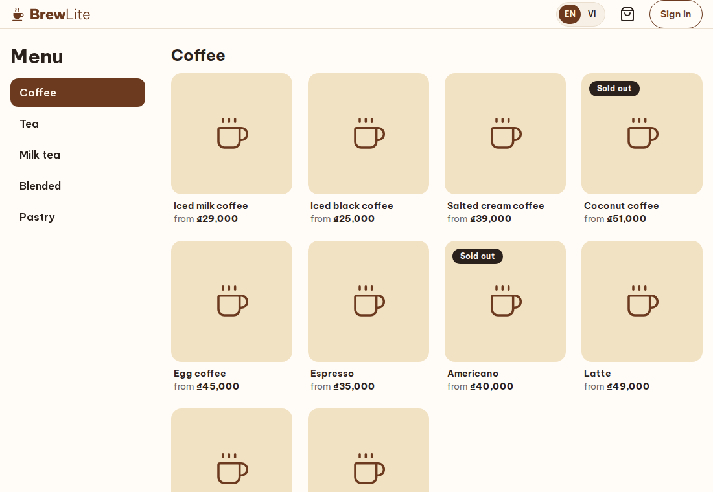
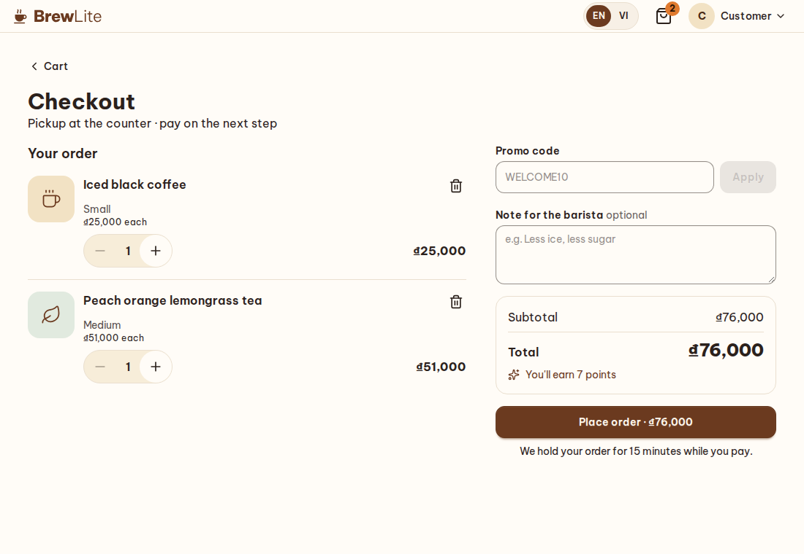
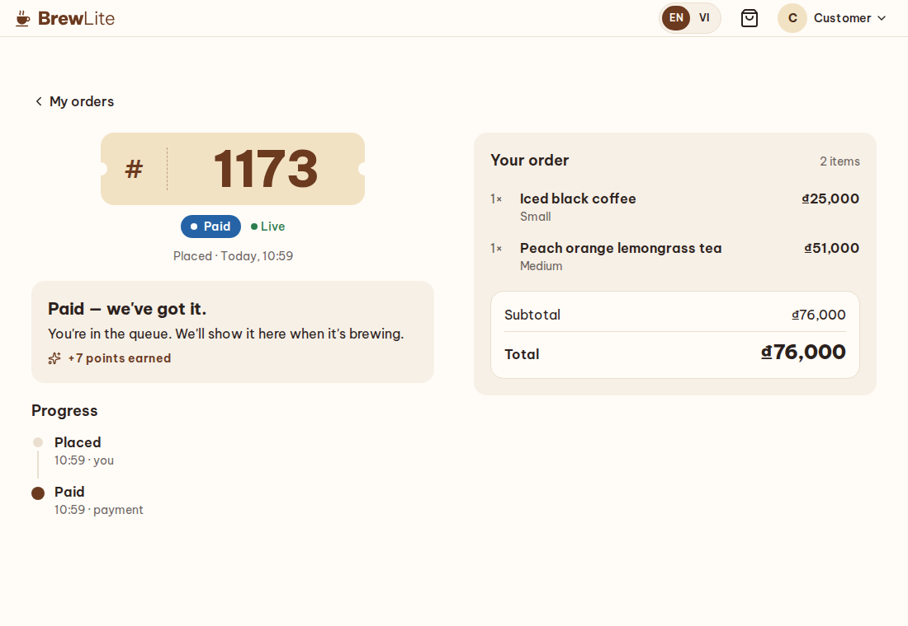
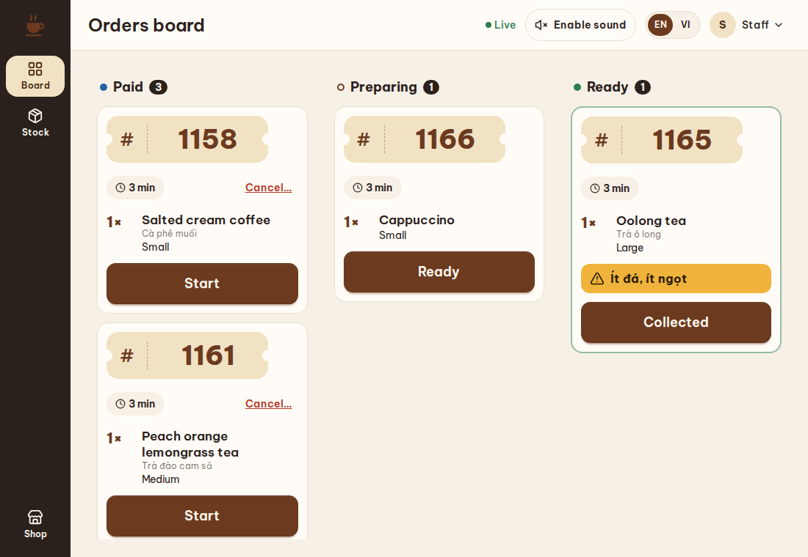

# BrewLite

**Order ahead and pay without cash at a small coffee shop.** A customer browses the menu without an account, builds a cart, signs in at checkout, pays by card through Stripe and watches the order go *paid → preparing → ready* live; staff work a real-time order board; an admin runs the menu, promotions, roles and sales. One store, pickup at the counter — no delivery, no tables, no cash.

BrewLite is a course project, built as a web app (Next.js) over a NestJS gateway and four domain services. It is meant to be read and run as much as used: the repository explains itself, and [`docs/`](docs/README.md) explains why it is built this way.

## Screens

| Menu | Checkout |
| :---- | :---- |
|  |  |
| **Order tracking** | **Staff board** |
|  |  |

## Features

- **Customer** — menu in English and Vietnamese, product options (size, toppings), a cart that survives a reload, sign-in with email or Google, a server-priced quote with promo codes, cashless payment, a live tracking page, order history and loyalty points.
- **Staff** — a live order board (*Paid → Preparing → Ready → Collected*), an alert for each new order, cancelling a paid order with a refund, marking drinks sold out and counting stock.
- **Admin** — categories, products with photos, toppings, promotions, users (role, lock, deactivate), every order with its timeline and payments, and a sales overview.

## Tech stack

| Layer | Choice |
| :---- | :---- |
| Web | Next.js 16 (App Router, Server Components and Actions), React 19, Tailwind with daisyUI, i18next |
| Backend | NestJS 11 — a gateway plus identity, catalog, ordering and payment services |
| Calls and events | gRPC between services; NATS JetStream with a transactional outbox for events |
| Data | PostgreSQL 18 (a database per service, Prisma 7), Redis for reconstructible state |
| Identity | JWT (ES256), Firebase Auth for Google sign-in (local emulator) |
| Payments | Stripe Checkout in test mode, or a built-in fake provider |

The reasons are in [architecture-and-tech-stack.md](docs/architecture-and-tech-stack.md) §1.

## Architecture

```text
browser ─▶ Caddy ─▶ web (Next.js) ─▶ gateway ─┬─▶ identity ─▶ PostgreSQL
                                              ├─▶ catalog  ─▶ PostgreSQL · Firebase Storage
                                              ├─▶ ordering ─▶ PostgreSQL
                                              └─▶ payment  ─▶ PostgreSQL · Stripe
              services ◀──── NATS JetStream (order and payment events) ────▶ services
```

Browsers only ever talk to the web app; the web server is the gateway's one client. Details and the event contracts: [architecture §2](docs/architecture-and-tech-stack.md#2-backend).

## Prerequisites

- **Node.js 24.14.0** (see `.nvmrc`) and **pnpm 10.34.5**, which Corepack provides.
- **Docker** with Compose v2.
- Free host ports in the `2xxxx` range (23000 web, 23100 gateway, 25432 PostgreSQL, …) — see [architecture §1.2](docs/architecture-and-tech-stack.md#12-running-beside-other-projects).

## Quick start

Run everything from the repository root.

1. Install the dependencies.

   ```bash
   corepack enable && pnpm install
   ```

2. Create each app's `.env` from its example (the web app and the five services).

   ```bash
   for s in services/* apps/*; do [ -f "$s/.env" ] || cp "$s/.env.example" "$s/.env"; done
   ```

3. Choose the password of the demo accounts — any 8 to 72 characters. It is left out of the example on purpose.

   ```bash
   echo 'SEED_ACCOUNT_PASSWORD=choose-a-password' >> services/identity/.env
   ```

4. Generate the JWT key pair (written into the identity and gateway `.env`, never committed).

   ```bash
   pnpm keys:dev
   ```

5. Start the infrastructure: PostgreSQL, Redis, NATS and the Firebase emulators.

   ```bash
   docker compose up -d --wait
   ```

6. Create the databases and run the migrations, then build (the seed scripts run from build output).

   ```bash
   pnpm db:setup && pnpm build
   ```

7. Start the apps — **either** on your machine with hot reload:

   ```bash
   pnpm dev
   ```

   **or** all in containers behind Caddy, which is how the course runs it:

   ```bash
   docker compose --profile apps up -d --build --wait
   ```

   If an image build fails with `EAI_AGAIN` (Docker's DNS), build that image on the host network and run the command again:
   `docker build --network host -f infra/docker/Dockerfile.service --build-arg SERVICE=gateway -t brewlite-gateway:latest .`

8. Fill the databases with a believable café — accounts, the menu, promotions and a month of orders. It needs `PAYMENT_PROVIDER=fake` in `services/payment/.env`, which is the example's default.

   ```bash
   pnpm seed:dev          # a plan: what it would create, nothing written
   pnpm seed:dev:apply    # a few minutes; safe to run again (it says "already present")
   ```

9. Open **<http://localhost:23000>**. The API documentation is at **<http://localhost:23100/docs>**.

If a step cannot bind a port, something else on your machine holds it: stop that, or see the port table in the architecture document.

## Demo accounts

| Account | Role | Sign in |
| :---- | :---- | :---- |
| `admin@brewlite.test` | admin — `/admin` | the `SEED_ACCOUNT_PASSWORD` you chose |
| `staff@brewlite.test` | staff — `/staff` | the same |
| `customer@brewlite.test` | customer | the same |
| `ha.nguyen@demo.brewlite.test` and seven more `@demo.brewlite.test` customers | customers with a month of orders and points | the same |

On the payment step, **Simulate success** and **Simulate failure** stand in for the card form. A guided tour for a demo or a recording is in [docs/demo.md](docs/demo.md).

## Payments

The fake provider is the default: it produces exactly the events Stripe's webhook would. To try Stripe in test mode:

1. In `services/payment/.env` set `PAYMENT_PROVIDER=stripe`, `STRIPE_SECRET_KEY` to a **restricted** test key (`rk_test_…`: Checkout Sessions write, Refunds write, Events read), and `WEB_URL=http://localhost:23000`.
2. Run `stripe listen --forward-to localhost:23100/api/webhooks/stripe` and put the `whsec_…` it prints in `STRIPE_WEBHOOK_SECRET`.
3. Restart the payment service. Card `4242 4242 4242 4242` pays; `4000 0000 0000 0002` is declined.

`pnpm seed:dev:apply` refuses to run against Stripe: a script cannot complete a card payment. More: [architecture §6](docs/architecture-and-tech-stack.md#6-payments--stripe-).

## Day-to-day commands

| Command | Does |
| :---- | :---- |
| `pnpm dev` | start the infrastructure, then every service and the web app with hot reload |
| `pnpm test` | unit tests, everywhere |
| `pnpm test:integration` | integration tests (needs the infrastructure up) |
| `pnpm --filter @brewlite/web e2e` | the browser tests against a running stack |
| `pnpm lint` · `pnpm typecheck` · `pnpm format:check` · `pnpm lint:md` | the other checks CI runs |
| `pnpm db:migrate:dev` | create a migration from a Prisma schema change |
| `pnpm proto:generate` | regenerate the gRPC code after a `.proto` change |
| `pnpm seed:dev` · `pnpm seed:dev:apply` | plan / create the demo café (step 8) |
| `pnpm perf` | latency of every main route against the seeded stack |

## Project structure

```text
brewlite/
├─ apps/web/        Next.js — customer, staff and admin pages in one app
├─ services/
│  ├─ gateway/      the only public HTTP API; no database
│  ├─ identity/     users, passwords, sessions, roles
│  ├─ catalog/      categories, products, toppings, images, stock
│  ├─ ordering/     quotes, orders, promotions, loyalty
│  └─ payment/      payments, Stripe, refunds
├─ packages/
│  ├─ contracts/    shared enums, limits, pricing, gRPC definitions
│  ├─ nest-common/  building blocks for the services
│  ├─ api-client/   the typed client generated from the gateway's OpenAPI
│  └─ config/       shared tooling configuration
├─ infra/docker/    Compose files, Dockerfiles, Caddy
├─ scripts/         keys, the demo seed, the latency check
└─ docs/            specifications and decisions
```

## Documentation

Start at the [documentation map](docs/README.md). The core documents:

- [product-overview.md](docs/product-overview.md) — what is built, the business rules and the user journeys.
- [architecture-and-tech-stack.md](docs/architecture-and-tech-stack.md) — technology, layout, ports, services, environment variables.
- [rdm-spec.md](docs/rdm-spec.md) — every table, column and constraint.
- [api-endpoints-plan.md](docs/api-endpoints-plan.md) — every endpoint, error code and event.
- [development-conventions.md](docs/development-conventions.md) — how the code is written.
- [decisions/](docs/decisions/) — why, one decision per file.

## Course tasks

Where each of the course's ten tasks is delivered: [product-overview §11.2](docs/product-overview.md#112-the-courses-ten-tasks).

## Licence

[MIT](LICENSE).
